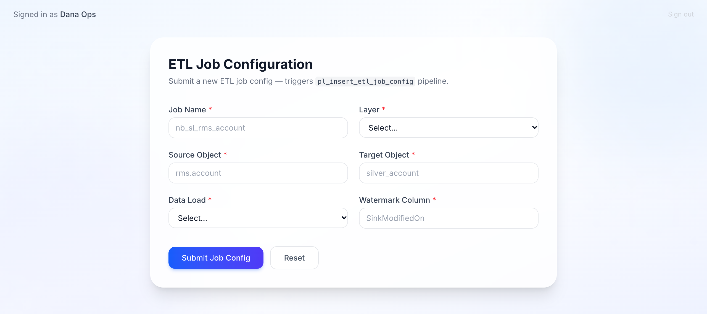
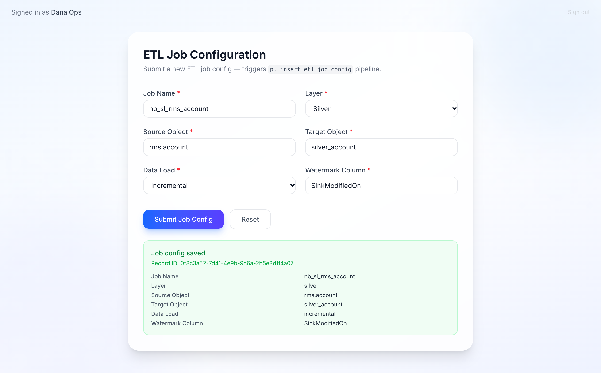

# ETL Job Configuration App

A Microsoft Fabric–authenticated web form for registering ETL job configurations.
Data engineers fill in the source/target objects and load strategy for a new job,
submit, and the config lands in the `EtlJobConfigIntake` table, where a
scheduled pipeline picks it up — no hand-editing config tables, no SQL access
required.

Built as a React + Vite single-page app on [Rayfin](https://www.npmjs.com/package/@microsoft/rayfin-core),
deployed to Fabric with Entra sign-in and a managed SQL backend.

## Screenshots

### Submitting a job config

The whole app is one screen: six required fields, inline validation, and a
confirmation showing exactly what was written.



### Confirmation

On success the saved record is echoed back with its generated ID, so you can
confirm the config landed before moving on.



### Sign-in

Access is gated behind Fabric brokered auth — the same Entra identity that
governs the workspace.


## What gets captured

Each submission writes one row to `EtlJobConfigIntake`:

| Field | Example | Notes |
|---|---|---|
| Job Name | `nb_sl_rms_account` | Notebook / job identifier |
| Layer | `silver` | One of staging, bronze, silver, gold |
| Source Object | `rms.account` | Schema-qualified source |
| Target Object | `silver_account` | Destination table |
| Data Load | `incremental` | Full or incremental |
| Watermark Column | `SinkModifiedOn` | Drives incremental loads |

Rows are written with `processed: false` and a `submittedAt` timestamp.

## How it runs today

The app's only job is the table write — it does not call the ETL pipeline
directly. `pl_insert_etl_job_config` runs **on a schedule**, picks up rows
where `processed = false`, applies them, and marks them processed. A config
submitted through the form therefore takes effect on the pipeline's next
scheduled run rather than immediately.

Two things follow from that:

- **Submissions are durable.** If the pipeline is down or mid-run, configs
  simply queue in the intake table until the next run picks them up.
- **Latency is the schedule interval.** Set it on the pipeline itself in
  Fabric (Data Factory → `pl_insert_etl_job_config` → Schedule), and match the
  interval to how quickly new job configs need to go live.

## Future work

**Direct pipeline trigger.** Submitting the form would start
`pl_insert_etl_job_config` straight away instead of waiting for the next
scheduled run. Most of the plumbing already exists:
`IAuthService.getFabricToken()` returns an Entra access token scoped for
`api.fabric.microsoft.com`, which is what the Fabric pipeline-run REST call
needs. What's missing is the call itself plus the UI states around it
(in-flight, failed-to-trigger, run ID).

Worth knowing: `MockAuthService.getFabricToken()` returns `null` by design, so
a direct trigger can only work against a real Fabric deployment — not the
local dev backend. The scheduled path above would stay as the fallback.

## Getting started

```bash
npm install

# Deploy backend services to Fabric and start the local dev server
npm run dev
```

Open [http://localhost:5173](http://localhost:5173).

`npm run dev` runs `rayfin up` first, which provisions the auth and data
services in Fabric and regenerates `.env.local` from `rayfin/.env`. Both of
those files hold deployment-specific values and are gitignored — a fresh clone
gets them by running the command above against its own Fabric workspace.

When the API URL points at localhost, the app swaps in `MockAuthService` and
signs into the bundled local backend with a fixture account, so you can work
without hitting Fabric.

## Project structure

```text
├── rayfin/
│   ├── rayfin.yml                 # Fabric service config (auth + data + hosting)
│   └── data/
│       ├── EtlJobConfigIntake.ts  # Entity definition — the intake table
│       └── schema.ts              # Schema registration
├── src/
│   ├── main.tsx                   # Entry point + Rayfin client bootstrap
│   ├── App.tsx                    # Routes and auth gate
│   ├── api/
│   │   └── jobConfig.ts           # createJobConfig() — writes the intake row
│   ├── pages/
│   │   └── HomePage.tsx           # The job config form
│   ├── components/
│   │   └── AuthPage.tsx           # Sign-in screen
│   ├── hooks/
│   │   └── AuthContext.tsx        # React context wrapping the auth helpers
│   └── services/
│       ├── IAuthService.ts        # Auth contract + AuthUser type
│       ├── MockAuthService.ts     # Local-dev impl (email/password)
│       ├── RayfinAuthService.ts   # Production impl (Fabric brokered auth)
│       ├── rayfinClient.ts        # Typed Rayfin client singleton
│       └── bootstrap.ts           # Reads env, picks the right auth service
└── package.json
```

## Scripts

| Command | Description |
|---------|-------------|
| `npm run dev` | Deploy backend to Fabric and start the local dev server |
| `npm run build` | Production build |
| `npm run build:fabric` | Build for Fabric deployment (entrypoint for `rayfin up`) |
| `npm run lint` | Lint with ESLint |
| `npm run test` | Run unit tests with Vitest |
| `npm run rayfin:up` | Deploy to Fabric without starting a dev server |
